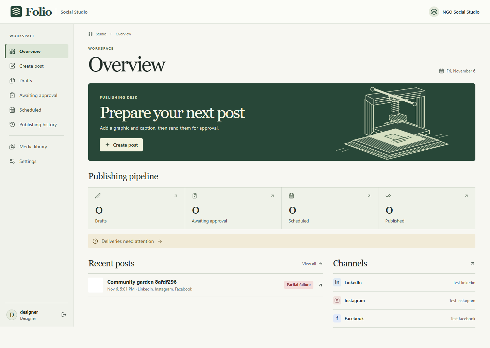
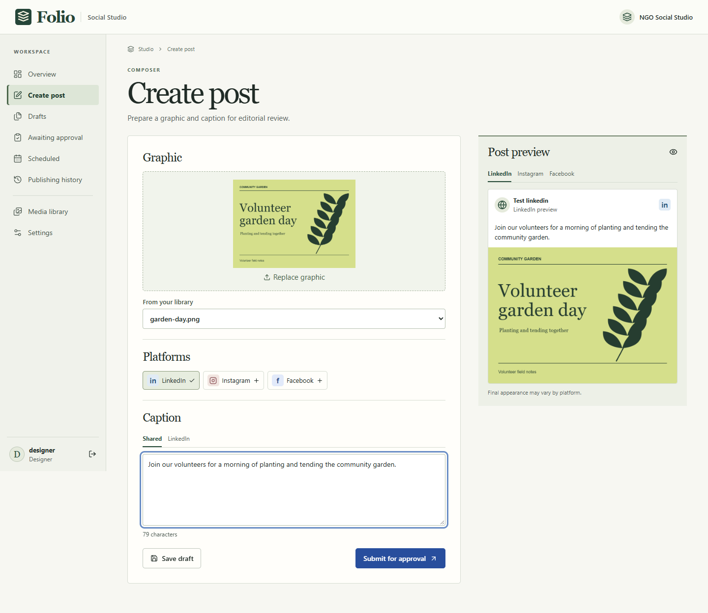

# Folio · NGO Social Studio

Folio is a private publishing desk for a nonprofit communications team. A designer prepares a graphic and captions. An administrator reviews the exact revision and authorizes distribution to the organization's LinkedIn, Instagram and Facebook accounts. In a configured deployment, Cloudflare Workers and Buffer handle delivery while team members are offline.

**Release status:** release candidate. The provider adapter uses the official Buffer API. Local verification uses Cloudflare's D1 emulator, Chromium, and an isolated mock publishing provider. Production identity, public image fetches from Buffer, live network delivery and recovery in the NGO's account require the deployment acceptance checks.



## Try it locally

Install Node 24.15 or later in the 24.x line and pnpm 11.25.0. Run these commands in the repository root:

```sh
pnpm install --frozen-lockfile
pnpm build
pnpm dev
```

Open **http://127.0.0.1:8787**. The loopback preview offers a Designer and an Administrator role. The first launch applies migrations and creates two local identities. Choose Designer, upload a PNG or JPEG in Create post, choose networks, write a caption, save and refresh. Submit for approval. Sign out and open the Administrator preview to review the post. Publishing is disabled in this preview. Local drafts and uploads persist in `.local/dev/state`. Rebuild the frontend after editing it and restart the preview.

## What works

- Role-scoped overview, media library, drafts, submissions and delivery history.
- Drag-and-drop or file-picker upload, immediate image preview, shared captions, per-channel overrides and previews. A tab keeps unsaved edits across navigation. Saved drafts and private image bytes persist together in D1.
- Review comments, changes requested, rejection, approval and auditable revision history. Material edits reopen approved content as a draft.
- A timezone-aware calendar, UTC schedules and snapshot-based channel jobs. Administrators can send approved content to the next cloud handoff or set a time at least ten minutes ahead. Scheduled results appear after Buffer accepts the individual channels.
- Per-channel results, external IDs, queue-limit feedback, cancellation when eligible, conservative retry, delayed reconciliation and a distinct unknown state for uncertain handoffs.
- Administrator-managed membership, organization settings and channel discovery. Production invites require both an active workspace membership and the organization's Access allow policy.
- A provider-neutral caption-assistance type is available for a later iteration. All current workflows use ordinary code.



## Project map

| Location        | Purpose                                                                                    |
| --------------- | ------------------------------------------------------------------------------------------ |
| apps/web        | React, Vite, Tailwind, design tokens and editorial screens                                 |
| apps/api        | Hono Worker, Access JWT verification, Drizzle membership lookup, media and Buffer delivery |
| packages/shared | Strict TypeScript models, caption validation and lifecycle display                         |
| migrations      | Versioned D1 SQLite tables, indexes and transactional triggers                             |
| scripts         | Loopback-only preview and isolated test identity/provider                                  |
| tests           | Vitest contract tests and Playwright browser/Worker integration                            |
| docs            | Decisions, actual browser captures, deployment and governance                              |

## Deployment and configuration

Follow [the Cloudflare runbook](docs/deployment/cloudflare.md) for a private workers.dev installation, remote migrations, first administrator, Access policies, Buffer setup, cloud cron, recovery and launch verification. Change the HTTPS media origin to use a custom domain later. Use separate Worker names, D1 databases, audiences and credentials for staging and production. Existing R2 installations must follow the runbook's image migration instructions before upgrading.

| Binding                        | Purpose                                          |
| ------------------------------ | ------------------------------------------------ |
| DB, ASSETS                     | D1 records and private images, compiled frontend |
| ACCESS_TEAM_DOMAIN, ACCESS_AUD | Exact Access issuer and application audience     |
| BUFFER_ORG_ID                  | Authorized Buffer organization for discovery     |
| MEDIA_ORIGIN                   | Stable HTTPS origin for approved delivery bytes  |
| BUFFER_API_KEY                 | Server-side Worker secret set with Wrangler      |

The app stores private uploads by random object ID. An approved handoff creates an independent unguessable delivery URL per job. Its public response is limited to eligible delivery states and a seven-day grace period after successful publication. Images retain their original bytes and metadata. The current validator checks supported image headers, structural markers, size, dimensions, pixel count and trailer. A full raster decoder and metadata stripping are outside this release.

## Verification

```sh
pnpm format:check
pnpm lint
pnpm typecheck
pnpm test
pnpm build
pnpm exec playwright install chromium
pnpm e2e
pnpm audit --prod --audit-level high
pnpm exec wrangler deploy --dry-run
```

On Linux CI, install Chromium with `--with-deps`. To use an existing Chrome installation, set `STUDIO_CHROME` to the executable path. Browser tests start isolated loopback Workers on ports 8791 and 8792, apply the real migrations, upload actual image bytes, and exercise the same API used in production. The test-only provider and clock controls are excluded from the production entry point. `STUDIO_SCREENSHOTS=1` captures the two workspace screens at desktop, tablet and mobile widths. Test state is stored beneath the ignored `.local` directory.

## Operating envelope

The first release serves one NGO per deployment, one graphic per post, one mapped channel per network and a small editorial team. The workspace loads its visible records together. Add pagination and data-retention controls before growing to a large archive. Provider statuses are eventually consistent. Unexpected responses and ambiguous timeouts require investigation. Keep account access, media backups, retention and publishing rights under NGO control.

For zero-spend hosting, keep Workers and D1 on Free and leave R2 disabled. Images are limited to 1 MiB each and 100 MiB in total. Free-plan quotas stop operations rather than enabling paid overages; the app never upgrades a plan. Access must also remain on its Free plan. Buffer Free's ten queued posts per channel is a simultaneous queue capacity. Account for separate API quotas. Check [Buffer limits](https://developers.buffer.com/guides/api-limits) and [Cloudflare quotas](docs/deployment/cloudflare.md#capacity) before launch.

## Contributing and rights

See [contribution guidelines](CONTRIBUTING.md), [security reporting](SECURITY.md), [conduct](CODE_OF_CONDUCT.md), [architecture decisions](docs/decisions/0001-runtime.md) and [GitHub setup](docs/deployment/github.md). [TASKS.md](TASKS.md) tracks milestones and external acceptance gates.

The [MIT license](LICENSE) covers this software and its original interface artwork. NGO names, trademarks, logos, uploaded photographs, designs and private records retain their respective owners' rights. Third-party packages and icons retain their own licenses. System fonts are referenced by name and are not redistributed.

## Provider references

The Buffer adapter follows the [GraphQL reference](https://developers.buffer.com/reference), [authentication guide](https://developers.buffer.com/guides/authentication), [stable media URL requirements](https://developers.buffer.com/guides/hosting-media) and [caption limits](https://developers.buffer.com/guides/character-limits).
